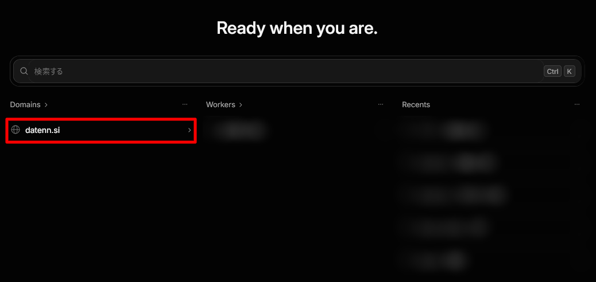
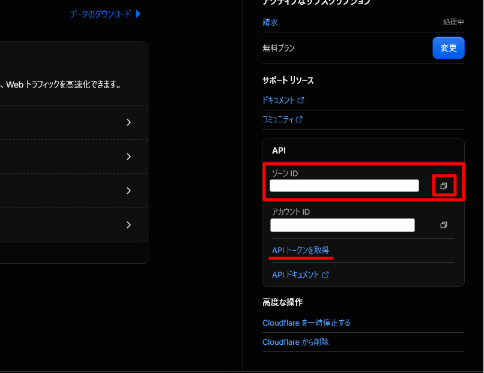
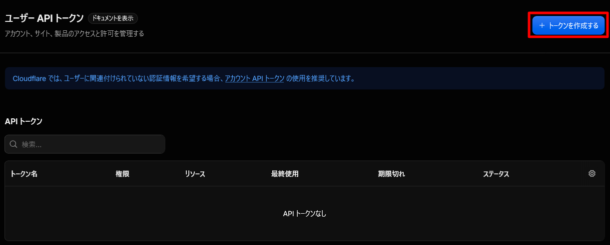
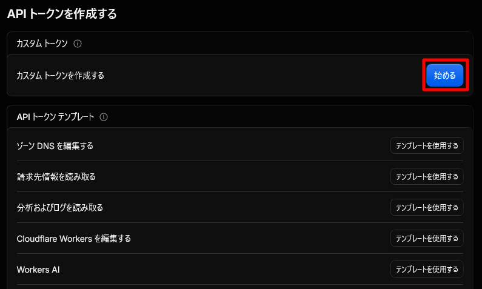
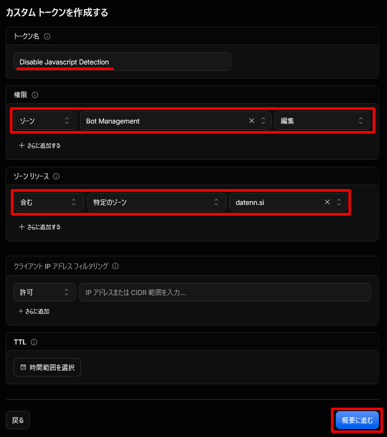
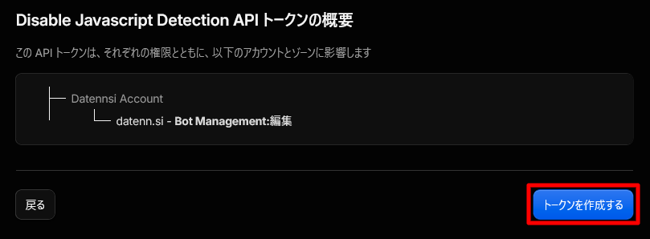
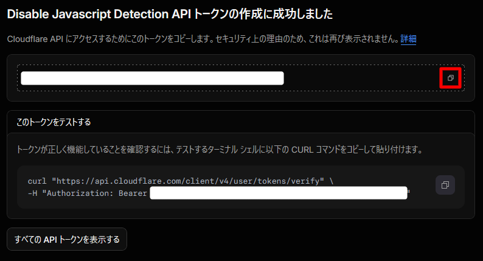
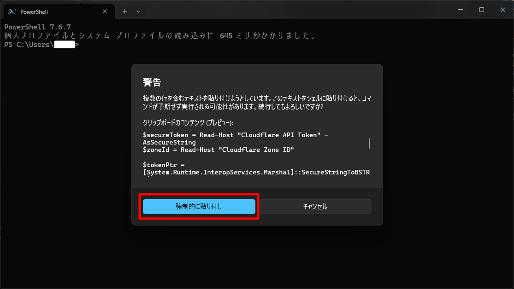
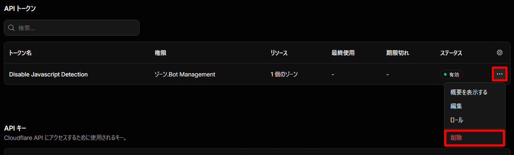
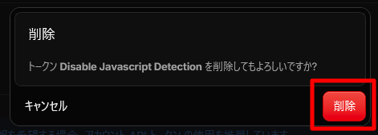

## はじめに

Cloudflare の Bot Fight Mode を先日有効にしてみたところ、JavaScript Detections のインラインスクリプトが挿入され、サイトに導入している CSP（Content Security Policy）がインラインスクリプトを許可していないためエラーが発生した。

https://developers.cloudflare.com/cloudflare-challenges/challenge-types/javascript-detections/#if-you-have-a-content-security-policy-csp

CSP には nonce というランダムな文字列をリクエストごとに生成して CSP ヘッダーとすべてのインラインスクリプトに設定し、クライアント側でそれを照合することで、インラインスクリプトを安全に実行する仕組みがある。

これを導入していれば、上記サイトにもある通り、Cloudflare 側が勝手に対応してくれるらしい。

とはいえ、Astro.js の静的レンダリングでは、上記に書いた通り動的な仕組みである nonce を導入するのは難しい。そのため、今回は JavaScript Detections を無効化することにした。

しかし、無料プランではダッシュボードから JavaScript Detections の有効・無効を切り替えられないようで、Bot Fight Mode を停止した後もインラインスクリプトが挿入され続けた。

Cloudflare API を利用することで設定を変更できたため、今回はその手順を残しておく。

## ダッシュボードからゾーン ID を取得する

Cloudflare のダッシュボードにアクセスし、対象のドメインを開く。



ページを下にスクロールすると、ゾーン ID が表示されている。API を呼び出す際に必要となるため、控えておく。



同じ画面から API トークンの取得ページへ移動する。

## 最小権限の API トークンを作成する

右上の `+ トークンを作成する` をクリックし、カスタムトークンの項目にある `始める` をクリックする。





以下の内容でトークンを設定する。

- トークン名: 自分が識別できる名前でよい。
- 権限: `ゾーン` → `Bot Management` → `編集`
- ゾーン: `含む` → `特定のゾーン` → 対象のドメイン
- クライアント IP アドレスフィルタリング: 必要に応じて、API を呼び出すネットワークのグローバル IP アドレスを指定する。
- TTL: 必要に応じて有効期間を指定する。



設定が完了したら `概要に進む` をクリックする。作成するトークンの権限を確認し、問題がなければ `トークンを作成する` をクリックする。



次の画面に API トークンが表示される。API トークンの表示画面を閉じると再表示できないため、安全な場所に保管する。



> [!WARNING]
> トークンの取り扱いには気をつけること。リポジトリ内に保存するなどしてはいけない。

## API を呼び出す

PowerShell で以下のコマンドを実行する。

> [!CAUTION]
> 必ず以下のコマンドが何を行うのか理解してから実行すること。わからないなら生成AIに質問するのもあり。

```powershell
$secureToken = Read-Host "Cloudflare API Token" -AsSecureString
$zoneId = Read-Host "Cloudflare Zone ID"

$tokenPtr = [System.Runtime.InteropServices.Marshal]::SecureStringToBSTR($secureToken)

try {
  $token = [System.Runtime.InteropServices.Marshal]::PtrToStringBSTR($tokenPtr)

  $request = Invoke-RestMethod -Uri "https://api.cloudflare.com/client/v4/zones/$zoneId/bot_management" `
    -Method Put `
    -Headers @{
      "Content-Type"  = "application/json"
      "Authorization" = "Bearer $token"
    } `
    -Body '{"enable_js": false, "fight_mode": false}'

  if (-not $request.success) {
    throw ($request.errors | ConvertTo-Json -Compress)
  }

  "enable_js={0}" -f $request.result.enable_js
}
finally {
  if ($tokenPtr -ne [IntPtr]::Zero) {
    [System.Runtime.InteropServices.Marshal]::ZeroFreeBSTR($tokenPtr)
  }

  $token = $null
  $secureToken.Dispose()
}
```

複数行の貼り付けに関する警告が出たら `強制的に貼り付け` を選択する。



`Cloudflare API Token:` と表示されたら API トークンを入力してエンター。安全のため入力内容は表示されない。

`Cloudflare Zone ID:` と表示されたらゾーン ID を入力してエンター。

この2つを入力すると、最後までコマンドが貼り付けられ、以下の状態で止まるので再度エンターを押して API にリクエストを送信する。

```powershell
PS C:\Users\xxxxxxxx> $secureToken = Read-Host "Cloudflare API Token" -AsSecureString
Cloudflare API Token:*****************************************************
PS C:\Users\xxxxxxxx> $zoneId = Read-Host "Cloudflare Zone ID"
Cloudflare Zone ID:xxxxxxxxxxxxxxxxxxxxxxxxxxxxxxxxxxxx
PS C:\Users\xxxxxxxx>
PS C:\Users\xxxxxxxx> $tokenPtr = [System.Runtime.InteropServices.Marshal]::SecureStringToBSTR($secureToken)
PS C:\Users\xxxxxxxx>
PS C:\Users\xxxxxxxx> try {
>>   $token = [System.Runtime.InteropServices.Marshal]::PtrToStringBSTR($tokenPtr)
>>
>>   $request = Invoke-RestMethod -Uri "https://api.cloudflare.com/client/v4/zones/$zoneId/bot_management" `
>>     -Method Put `
[ ------------ 略 ------------ ]
>>
>>   $token = $null
>>   $secureToken.Dispose()
>> }
```

下記のように表示されたら更新に成功している。

```powershell
enable_js=False
```

## 設定が反映されたか確認する

### ブラウザで確認する

ブラウザで対象のサイトを開き、開発者ツールを使って以下を確認する。

- CSP を導入していてインラインスクリプトを許可していない場合は、コンソールに CSP 違反のエラーが出ていないこと。
- HTML の末尾付近などに、Cloudflare によって挿入された JavaScript Detections のスクリプトが残っていないこと。

スクリプトが残っている場合は、ブラウザ側でスーパーリロードやキャッシュの削除を試す。それでも解消しない場合は、Cloudflare 側の反映待ちが疑われる。

### PowerShell から確認する

PowerShell から確認する場合は、以下のスクリプトを実行する。

> [!CAUTION]
> 必ず以下のコマンドが何を行うのか理解してから実行すること。わからないなら生成AIに質問するのもあり。

```powershell
$url = Read-Host "確認するサイトのURL（例: https://example.com/）"

$html = (Invoke-WebRequest $url -UserAgent 'Mozilla/5.0').Content
$html -match 'challenge-platform/.*/jsd/'
```

こちらも先程と同様に複数行貼り付けに関する警告が出るので、`強制的に貼り付け` を選択して進める。

サイトのURLを入力してエンターを押したら、以下の状態で止まるので再度エンターを押す。

```powershell
PS C:\Users\xxxxxxxx> $url = Read-Host "確認するサイトのURL（例: https://example.com/）"
確認するサイトのURL（例: https://example.com/）:https://datenn.si/
PS C:\Users\xxxxxxxx> $html = (Invoke-WebRequest $url -UserAgent 'Mozilla/5.0').Content
PS C:\Users\xxxxxxxx> $html -match 'challenge-platform/.*/jsd/'
```

下記のように表示されたらスクリプトの文字列が検知されなかったことになる。

```powershell
False
```

ただし、この方法は HTML 内の文字列を検索しているだけであり、JavaScript Detections が完全に無効化されていることを保証するものではない。必要に応じて、ブラウザの開発者ツールでも確認する。

## API トークンを削除する

設定変更と動作確認が完了したら、作成した API トークンを削除する。不要になったトークンを残さないことで、不正利用のリスクを抑えられる。

[https://dash.cloudflare.com/profile/api-tokens](https://dash.cloudflare.com/profile/api-tokens) から API トークンを管理できる。

> [!WARNING]
> 誤ったトークンを削除しないように気をつけること。

今回作成したトークンの `…` をクリックして、`削除`を選択する。



`削除`を押して API トークンを削除する。



## おわりに

API から設定を変更できるのであれば、ダッシュボードにも設定項目を用意してほしいところだ。

とはいえ、API トークンを作成して PowerShell から数行のコマンドを実行するだけで設定を変更できる。そのため、JavaScript Detections が無効にできなくて CSP と競合するなどした際は試してみてほしい。
